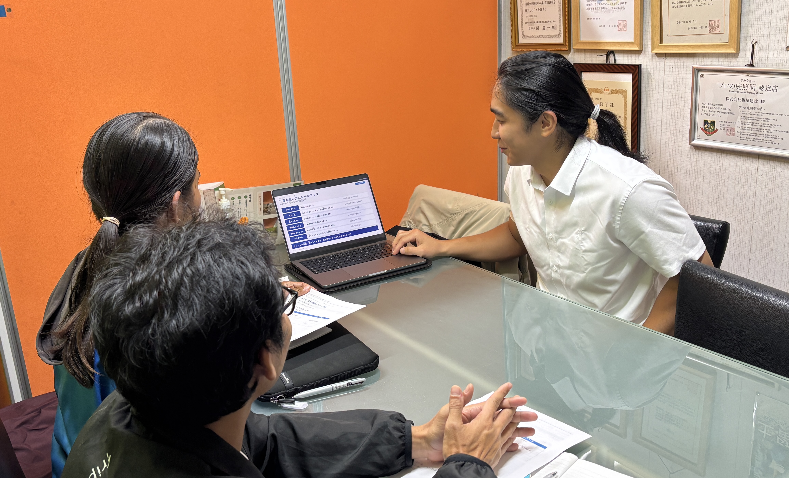

## 外国籍社員の「はい」、本当に伝わっていますか？

上司　：「終わったら、急いで片付けておいて」

授業員：「はい、わかりました」。

　ところが見に行くと、何も進んでいない事情が外国人社員を迎えた中小企業の現場でよく聞くお話です。

・文字やAI翻訳なら理解できるのに、口頭では伝わらない

・わからなくても「わかりません」と言えず、「はい」と答えてしまう

・「急いで」の緊急度や、現場の空気が伝わらない

　本人は真面目だからこそ、聞き返すことを遠慮しています。教える側も、社長や上司が本業の合間に資料を手作りし、「何度も言ったのに」と疲れてしまいます。

## 建設会社様で日本語研修の開始

　弊社は2026年11月より、浜松市内の建設会社様で、ミャンマー出身の社員3名を対象とした日本語研修を開始しました。週１日60分、少人数制で行っています。

図：日本語研修の様子

　外国籍従業員が直面するのは日本語の知識ではなく、日本人同僚や上司間の会話能力です。いくら日本語能力試験に合格したとしても『通じる会話能力』は現場で活かしてから初めて身につくものです。そのために初回の研修では自然文・発音を中心した練習および指示が理解できるまで確認する練習も行いました。２回目以降の研修では「報・連・相」をはじめ、日本職場における「慣習」や「見えないルール」に対して外国籍従業員の視点（弊社スタフ）から徹底的に研修を行っています。また、各研修の後には外国籍社員お一人おひとりの理解度をまとめた授業報告書を企業様へお届けしています。

## 講師はミャンマー出身の弊社スタッフ

　弊社のスタッフの中にはミャンマー出身、日本語能力試験N1、TOEIC 900点以上の取得者がいるため、日本語・ミャンマー語・英語の3言語で対応できます。静岡県警察西部運転免許センターでの外免切替面接の通訳も担当しました。外国籍従業員自身も日本語を学んできたからこそ、受講者がどこでつまずくのかがわかり、マナーの「なぜ」をミャンマー語で補って説明できます。

　外国人社員の日本語でお困りの際は、お気軽に[\[お問い合わせ\]](https://empowerandlink.com/contact/)ください。